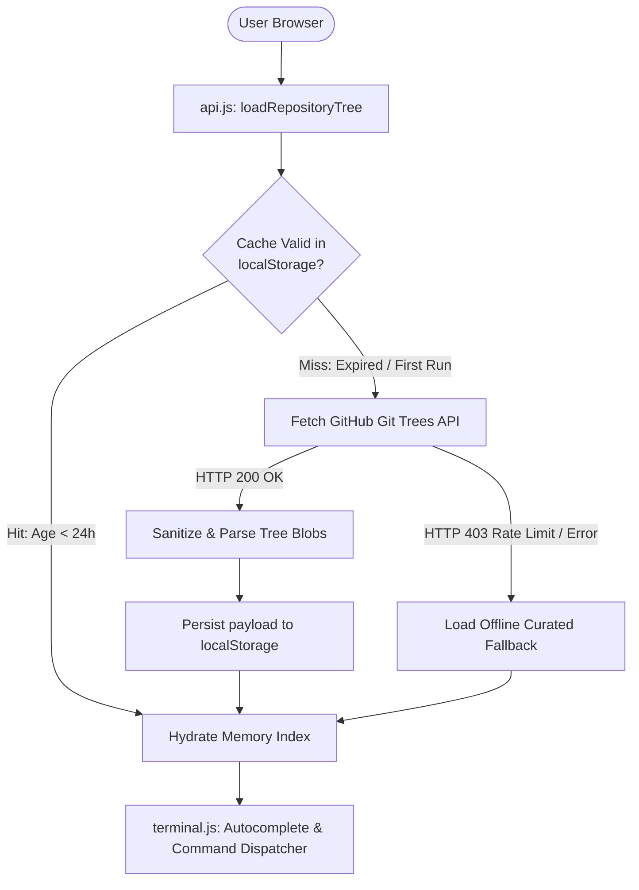
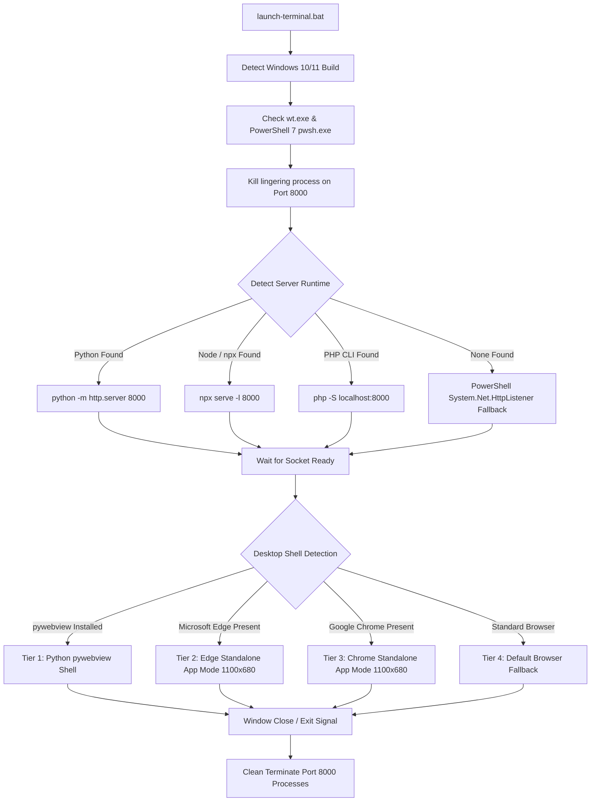

# System Architecture & Technical Specifications

This document outlines the architectural blueprint, client-side indexing engine, storage caching system, polyglot desktop launcher hierarchy, and enterprise alignment tooling implemented in the **Windows 11 Terminal — Web Explorer** for `rajghosh06-dev/Programming-Related`.

---

## 1. Zero-Backend Client-Side Indexing Engine

The application delivers sub-millisecond search across 4,400+ coursework assets without requiring dedicated server infrastructure, databases, or microservice backends.



### GitHub Git Trees Recursive API
The primary data source is GitHub's Git Trees API:
```http
GET https://api.github.com/repos/rajghosh06-dev/Programming-Related/git/trees/main?recursive=1
Accept: application/vnd.github.v3+json
```
- **Single HTTP Request**: By querying the Git Tree recursively at branch `main`, the explorer retrieves the complete metadata hierarchy for thousands of files in a single compressed JSON payload.
- **Tree Normalization**: Blobs (`type: "blob"`) and sub-trees (`type: "tree"`) are extracted, mapped with path strings, byte sizes, and access modes (`100644` standard blob, `040000` directory tree).
- **In-Memory Trie & Substring Lookup**: Autocomplete operates entirely in client RAM. Queries prefixed with `@` perform real-time substring filtering against cached paths with sub-millisecond response times.

---

## 2. Storage & Rate-Limit Management

GitHub restricts unauthenticated IP addresses to 60 API requests per hour. To guarantee resilience and uninterrupted operation, a strict two-layer caching and quota engine is enforced.

### 2.1 24-Hour TTL Persistent `localStorage` Cache
Indexed repository trees are serialized and stored directly in browser `localStorage`:
- **Cache Keys**:
  - `pwsh_gh_tree_cache_rajghosh06`: Serialized JSON array of repository entries.
  - `pwsh_gh_tree_cache_time_rajghosh06`: Unix epoch timestamp of initial fetch.
- **Time-to-Live (TTL)**: `24 hours` (`86,400,000 ms`).
- **Cache Hit Validation**: Upon every page boot, the engine checks whether `Date.now() - timestamp < ttlMs`. If valid, the network request is completely bypassed, eliminating latency and preserving API quotas.

### 2.2 6-Count Session Refetch Quota Guard
Manual cache invalidation can be initiated by the user via `/re-fetch`. To prevent rate-limit exhaustion:
- An ephemeral session counter (`pwsh_gh_refetch_quota_session`) tracks manual refresh invocations.
- A hard quota limit of **6 refetches per session** is enforced.
- When the quota is exceeded, `/re-fetch` blocks the network call and alerts the user with remaining session lifetime data.

### 2.3 Curated Offline Fallback Dataset
If network access is unavailable or an unauthenticated rate-limit (HTTP 403) is encountered on first boot, `api.js` automatically fails over to an internal curated dataset (`OFFLINE_FALLBACK`) containing primary coursework directories (`1st-Year`, `2nd-Year`, `3rd-Year`, `CN`, `tools`, `LICENSE`, `README.md`).

---

## 3. Multi-Tier Standalone Desktop Runtime (`launch-terminal.bat`)

The terminal can be launched as an isolated native desktop application on Windows using `launch-terminal.bat`. The launcher executes environment baselining, spawns an isolated background web server, and boots the application through a 4-tier desktop shell hierarchy.



### 3.1 Local Server Runtime Hierarchy
The script searches system PATH for available web servers in descending order:
1. **Python**: `python -m http.server 8000`
2. **Node.js**: `npx --yes serve -l 8000 .`
3. **PHP CLI**: `php -S localhost:8000`
4. **PowerShell Fallback**: A custom, zero-dependency background HTTP server utilizing `System.Net.HttpListener`:
   ```powershell
   $listener = New-Object System.Net.HttpListener
   $listener.Prefixes.Add('http://localhost:8000/')
   $listener.Start()
   while ($listener.IsListening) {
       $ctx = $listener.GetContext()
       # Serves HTML, CSS, JS, JSON with proper Content-Type headers
   }
   ```

### 3.2 Desktop Window Hierarchy
Once the local server is listening, the window manager is selected:
- **Tier 1 (pywebview)**: Creates a dedicated OS window with native frame controls without browser chrome.
- **Tier 2 (Microsoft Edge App Mode)**: `msedge.exe --app=http://localhost:8000 --window-size=1100,680`.
- **Tier 3 (Google Chrome App Mode)**: `chrome.exe --app=http://localhost:8000 --window-size=1100,680`.
- **Tier 4 (System Default)**: Launches default browser via Windows shell association.

---

## 4. Cisco Packet Tracer Lab Alignment Architecture

Cisco Packet Tracer uses a proprietary XML/binary hybrid container (`.pkt`). Network topologies generated in newer or older builds frequently fail with unrecoverable XML parsing errors when opened across mismatched versions.

### 4.1 Target Specification
Coursework lab topologies within `rajghosh06-dev/Programming-Related` (such as `DistanceVector.pkt`) are strictly aligned to:
```javascript
export const COMPATIBLE_PKT_VERSION = "9.0.1.0858";
export const COMPATIBLE_PKT_VERSION_PREFIX = "9.0.1";
```

### 4.2 Deep Registry Scanning & Silent Inno Setup Removal
To resolve version mismatch conflicts, the `/install-cisco-pkt-compatible` automation deploys a script (`install-cisco-pkt-compatible.bat`) that performs:
1. **Administrator Self-Elevation**: Invokes UAC prompt via `Start-Process cmd -Verb RunAs`.
2. **Registry Introspection**: Scans both 64-bit and 32-bit uninstall registries:
   - `HKLM:\SOFTWARE\Microsoft\Windows\CurrentVersion\Uninstall\*`
   - `HKLM:\SOFTWARE\WOW6432Node\Microsoft\Windows\CurrentVersion\Uninstall\*`
3. **Silent Clean Removal**: If an installed Packet Tracer build differs from `9.0.1.0858`, the uninstaller is executed with silent Inno Setup parameters:
   ```cmd
   unins000.exe /VERYSILENT /SUPPRESSMSGBOXES /NORESTART
   ```

### 4.3 3-Tier Installation Pipeline
Once the environment is cleanly prepared, the target build is deployed:
1. **Tier 1 — Windows Package Manager (`winget`)**:
   ```cmd
   winget install --id Cisco.PacketTracer --version "9.0.1.0858" -e --silent --accept-source-agreements --accept-package-agreements
   ```
2. **Tier 2 — Chocolatey (`choco`)**:
   ```cmd
   choco install packettracer --version "9.0.1" -y --allow-downgrade
   ```
3. **Tier 3 — Direct Cryptographic Verified Fallback**:
   Downloads the authentic standalone installer binary via TLS 1.2 from archive mirror storage and executes silent setup parameters.

---

## 5. UI Architecture & Terminal State Machine

The interface mirrors the authentic Windows 11 Terminal with PowerShell 7 profile styling:
- **Canvas**: Monospace `#0C0C0C` background, `#CCCCCC` body text, `#4EC9B0` accent highlights.
- **Custom Block Caret (`#customCaret`)**: Synchronized to an off-screen measuring span with sub-character tracking. When blurred, the caret shifts from a solid green block (`#13A10E`) to a persistent outline stroke.
- **Interactive Suggestions Dropdown**: Suggestions are rendered in a clean 4-line fixed-height viewport with smooth scrolling, keyboard `Up`/`Down`/`Enter`/`Tab` interaction, and ASCII type indicators (`[DIR]`, `[FILE]`).
- **Context Action Modal**: Selecting an item presents numbered contextual actions (GitHub Tree/Blob, Raw Stream, Copy Path, Direct Download).

---

## 6. CLI Authentication & Session Security Subsystem

A client-side security gate protects access to repository assets, administrative tooling, and live presence nodes.

### 6.1 Cryptographic Architecture
- **Web Crypto API**: SHA-256 hashing executed via native browser primitives (`crypto.subtle.digest`). Plaintext passwords are never stored in memory or sent across network streams.
- **Cryptographic Salting**: SHA-256 hashing prepends a unique repository salt prefix (`pr-salt-2026:`) to prevent rainbow table or precomputed dictionary attacks.
- **First-Time Password Initialization**: Unregistered whitelisted users are guided through interactive initialization (`min 8 characters`, password confirmation, and keystroke masking).

### 6.2 Hard 3-Hour Session Timeout
- Sessions are stored strictly within ephemeral `sessionStorage` (`auth_user`, `auth_role`, `auth_login_time`).
- An active timer enforces a hard logout after **3 hours** (`10,800,000 ms`).
- Closing the browser tab or window purges `sessionStorage` instantly, resetting the terminal state to `AUTH_USERNAME`.

### 6.3 Strict Privacy & Identity Masking
- System administrative accounts are masked in all public UI touchpoints, CLI boot banners, login gates, and hover cards, displaying only generic identifiers (`Administrator` or `Admin`).
- Unauthorized login attempts produce sanitized responses without exposing account existence.

---

## 7. Multi-Device Real-Time Cloud Presence Engine

The terminal maintains bi-directional synchronization with Firebase Realtime Database to display live multi-device sessions and activity states.

### 7.1 Connection Lifecycle & Heartbeat
- Listens to `.info/connected` on Firebase RTDB.
- On connection, writes `/presence/{sessionId}` with current user identity, window state, and server timestamp.
- Hooks `.onDisconnect().remove()` to clean up dead sessions immediately when tabs close or network connections drop.

### 7.2 Window Activity Introspection
- Dynamically binds to `window.focus`, `window.blur`, and `document.visibilitychange`.
- Focused active tabs update status to `"active"` (pulsing green indicator `#16c60c`).
- Background tabs or blurred windows switch state to `"idle"` (yellow indicator `#e5c07b`).
- Whitelisted peers not currently connected are dynamically listed as offline (`#e81123`).
